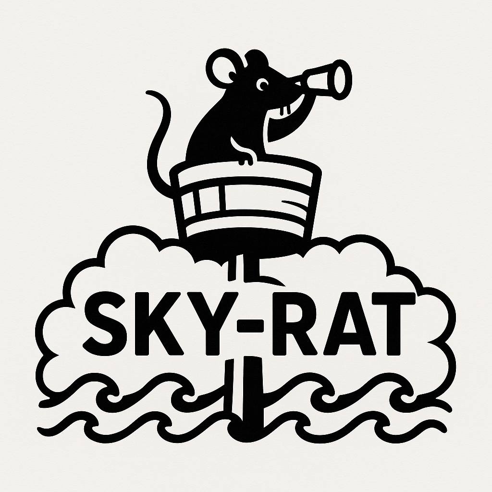

# SKY-RAT Boshrelease

<table>
  <tr>
    <td style="width: 300px"></td>
    <td style="width: 400px">
        <b>Sky-rat</b> (noun, slang): A humorous or mildly teasing nickname used by sailors to refer to the lookout stationed in
        the crow's nest of a ship. The term plays on the idea of someone being high up in the sky (on the mast) and constantly
        watching, like a rat scurrying about up high. It’s not offensive, but rather a playful jab among crewmates, often used
        when someone spends a lot of time in the lookout post or complains about the duty.
    </td>
  </tr>
</table>


## Tests

```sh
bundle install
bosh sync-blobs          # packaging specs build every package from local blobs
bundle exec rspec        # all specs
bundle exec rspec --tag ~packaging   # template rendering only (no blobs needed)
```

- `spec/jobs/` – renders every job template with `bosh-template` and checks the output (valid bash/YAML, flags, quoting).
- `spec/packaging_spec.rb` – runs each `packaging` script in a sandbox and verifies that all flags/env vars
  rendered by the job templates are accepted by the packaged binary (`--help`). Run it after every blob bump.
